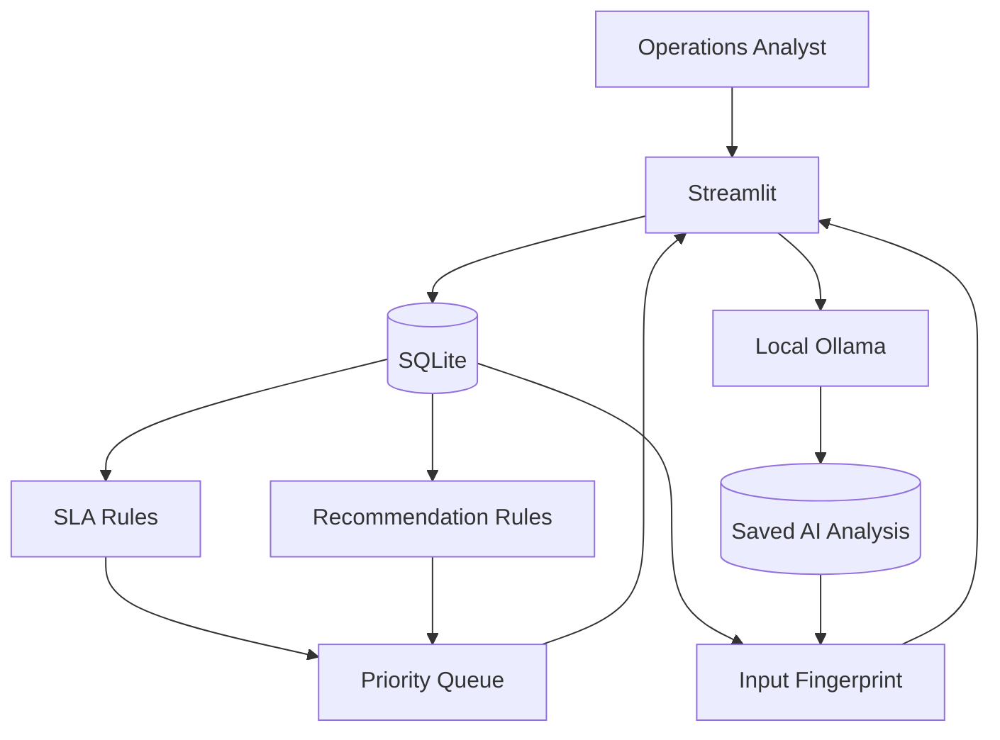

# AI-Powered Tax Operations Intelligence & SLA Prevention Engine

**Python · Streamlit · SQLite · Ollama · pandas · unittest**

An independent, local-first prototype demonstrating
how deterministic operational rules and advisory AI
can support tax operations case management.

> This project uses synthetic examples. It is not
> affiliated with Rippling or any government agency.
> It is not a production tax-compliance system.

## The Problem

Operations analysts may need to manage multiple
cases with different SLA commitments, customer
dependencies, external agency blockers, and
documentation requirements.

Without a consistent prioritisation workflow,
it can be difficult to distinguish urgent cases
from cases requiring routine follow-up.

## The Solution

This prototype brings together:

1. Case intake and SQLite persistence
2. Business-hour and calendar-hour SLA modeling
3. Risk-based operational prioritisation
4. Context-aware next-action recommendations
5. Local AI-assisted case classification
6. AI freshness checks after case changes
7. Case lifecycle audit history
8. Synthetic evaluation and automated validation

## Architecture



The SLA engine and recommendation engine use
deterministic Python logic.

Ollama provides advisory analysis and does not
override the SLA rules.

## Technology Stack

| Layer | Technology |
|---|---|
| Application | Streamlit |
| Language | Python |
| Data processing | pandas |
| Persistence | SQLite |
| Local AI | Ollama, qwen3:8b |
| Testing | unittest |
| Data | Synthetic cases |

## SLA Policy

The business-hours model assumes:

- Monday–Friday
- 09:00–18:00
- No public holidays
- No timezone conversion
- No SLA pauses

The live priority queue places active cases first,
then orders by risk, deadline, and case ID.

## Original 50-Case Simulation

Under the modeled business-hours policy:

| Classification | Count |
|---|---:|
| Breached | 2 |
| At Risk | 5 |
| Within SLA | 43 |
| Total | 50 |

These are fixed synthetic simulation outcomes,
not measured operational improvements.

The calendar-hours comparison demonstrates
sensitivity to SLA policy assumptions.

## AI Evaluation

AI classification was evaluated against
provisional synthetic reference labels.

The evaluation is not an independently verified
measure of real-world model accuracy.

Raw model and hybrid prediction results must
not be conflated.

See the technical documentation for the
evaluation methodology and limitations.

## Validation

The project includes:

- Deterministic priority-ordering tests
- Recommendation-rule tests
- Isolated SQLite lifecycle and audit tests
- Input fingerprint and freshness tests
- Original simulation consistency checks

The isolated integration suite passed eight tests
during local validation.

Seven additional manual application checks
were reported as passed.

The automated suite does not test a production
deployment or regulatory compliance.

## Repository Contents

```text
Dashboard/
  app.py
  ai_engine.py
  case_intake.py
  case_lifecycle.py
  case_intelligence.py
  recommendation_engine.py
  evaluate_ai.py
  priority_validation.py
  test_priority_validation.py
  test_integration.py
  run_priority_validation.py
  run_integration_validation.py
docs/
  ARCHITECTURE.md
  TECHNICAL_DESIGN.md
  DEMO_SCRIPT.md
  PROJECT_SUMMARY.md
```

## Local Development

The prototype was developed in a Windows
Anaconda environment.

Core application dependencies include
Python, pandas, Streamlit, and Ollama.

A local Ollama installation with qwen3:8b
is needed for live AI inference.

```bat
conda activate taxops
cd Dashboard
streamlit run app.py
```

Open http://localhost:8501

### Important Setup Limitation

This public source-code package intentionally
excludes the local SQLite database, saved
prediction files, and simulation output.

Consequently, it is a **code-review package**,
not a fully reproducible one-command demo.

The complete demonstration runs in the
original local development environment.

Do not use the packaged source alone to
claim that all functionality can run without
the excluded data artifacts.

## Security and Privacy

- No real customer information is required
- Local SQLite data is excluded
- Model inference runs locally
- Secrets and machine-specific files are excluded
- No production authentication is implemented

## Known Limitations

- Synthetic reference data
- No independently verified agency deadlines
- No holiday-aware SLA calendars
- No timezone or SLA pause support
- No role-based access controls
- No automated browser-level testing
- No independently measured reduction in breaches
- No production-scale performance validation

## Future Improvements

- Portable synthetic demo fixtures
- Independent human-reviewed evaluation labels
- Holiday-aware and configurable SLA policies
- Role-based access and authentication
- Automated end-to-end browser tests
- Containerized development environment
- Human feedback on AI recommendations

## Project Context

Independent educational and technical
portfolio project demonstrating operations
automation, technical implementation,
and explainable AI system design.
