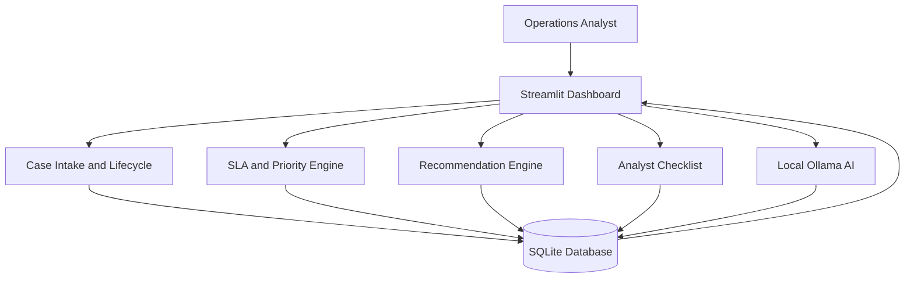

# AI-Powered Tax Operations Intelligence & SLA Prevention Engine

**Python · Streamlit · SQLite · Ollama · pandas · unittest**

A local-first operational intelligence prototype designed to help analysts prioritize tax operations cases, identify SLA risks, manage external dependencies, and track recommended actions through an auditable workflow.

> **Disclaimer:** This is an independent portfolio project using synthetic data. It is not affiliated with Rippling or any government agency and is not a production tax-compliance platform.

## 1. Business Problem

Tax operations teams may handle numerous cases involving employer registrations, agency notices, missing documentation, and customer or government-agency dependencies.

Without structured prioritization and execution tracking, analysts may struggle to identify which cases require immediate attention, what actions should be taken, and whether previous work has been completed.

## 2. Solution Overview

The application combines deterministic operational rules, advisory AI analysis, and persistent case-management workflows.

Key capabilities include:

- **Case Intake:** Capture and store new cases in SQLite.
- **SLA Intelligence:** Calculate modeled SLA risk and prioritize operational cases.
- **Context-Aware Recommendations:** Suggest next actions based on case status, dependencies, and operational context.
- **Analyst Action Checklist:** Generate workflow-specific tasks and preserve their completion status.
- **Workflow Transition Management:** Support case-status changes while retaining previous checklists.
- **Audit History:** Record case changes and checklist activity for traceability.
- **Local AI Analysis:** Use Ollama for advisory case analysis without overriding deterministic SLA rules.

## 3. System Architecture



The application uses deterministic Python logic for operational prioritization and recommendations. Local AI provides supporting analysis rather than making autonomous compliance decisions.

## 4. Technology Stack

| Component | Technology |
|---|---|
| Programming language | Python |
| User interface | Streamlit |
| Database | SQLite |
| Data processing | pandas |
| Local AI | Ollama with qwen3:8b |
| Automated validation | unittest and Python test scripts |
| Version control | Git and GitHub |

## 5. Quick Start

### Prerequisites

- Python environment with the required dependencies
- Ollama installed locally for AI inference
- The `qwen3:8b` model downloaded if live AI analysis is required

### Installation

Clone the repository:

```bash
git clone https://github.com/PMF-agent/tax-operations-ai-intelligence.git
cd tax-operations-ai-intelligence
```

Install Python dependencies:

```bash
python -m pip install -r requirements.txt
```

Create the synthetic demo database:

```bash
python initialize_demo_db.py
```

Launch the application:

```bash
python -m streamlit run Dashboard/app.py
```

Open `http://localhost:8501` in your browser.

For local AI inference, install Ollama and download the configured model:

```bash
ollama pull qwen3:8b
```

The dashboard's deterministic operational features can be used independently of live AI inference, subject to the application's configured dependencies.

## 6. Analyst Action Checklist

The checklist module converts recommended operational actions into trackable tasks.

For example, an Agency Follow-up workflow can contain tasks for verifying the agency submission and documenting follow-up activity.

When a case transitions to a Customer Follow-up workflow:

1. The recommendation engine identifies the new action type.
2. The application generates the corresponding checklist.
3. Previously completed agency tasks remain preserved.
4. Checklist completion events remain available in the audit history.

### Verified workflow example

A synthetic test case, `TX-1051`, was transitioned from `Pending Agency` to `Pending Customer`.

The resulting SQLite verification confirmed:

| Item | Verified result |
|---|---|
| Case status | Pending Customer |
| Previous agency checklist | 6 tasks preserved |
| Previously completed agency tasks | 1 |
| New customer checklist | 4 tasks |
| Previous checklist completion event | Preserved |

This demonstrates workflow isolation and historical traceability.

## 7. SLA Modeling

The business-hours SLA simulation uses the following assumptions:

- Monday through Friday
- 09:00–18:00 business hours
- No public holidays
- No timezone conversion
- No automatic SLA pauses

The original 50-case simulation produced:

| Classification | Cases |
|---|---:|
| Breached | 2 |
| At Risk | 5 |
| Within SLA | 43 |
| Total | 50 |

These are modeled synthetic outcomes, not measured operational improvements.

## 8. Validation

The project has undergone local validation covering:

- Priority-ordering logic
- Context-aware recommendation rules
- Case lifecycle and audit history
- AI input freshness checks
- Checklist creation and persistence
- Checklist workflow isolation
- Status transitions and historical preservation
- Fresh synthetic database initialization
- Dashboard startup against an independently generated database

The database initializer was tested in an isolated Windows temporary directory and successfully generated 50 synthetic cases with SQLite integrity verification.

The isolated dashboard also loaded successfully, displayed the synthetic cases, generated context-aware recommendations, and showed the Analyst Action Checklist.

These results are local development validations, not evidence of production readiness.

## 9. Security and Data

- All included demonstration records are synthetic.
- Local SQLite databases are excluded from Git tracking.
- Secrets and environment files are excluded through `.gitignore`.
- Local AI inference does not require sending case information to a hosted AI provider.
- The prototype does not implement production authentication or role-based access control.

## 10. Known Limitations

- Synthetic data rather than real operational records
- Simplified SLA calendar assumptions
- No production authentication or authorization
- No independently verified regulatory deadlines
- No automated browser-level end-to-end test suite
- No production-scale performance testing
- No independently measured reduction in SLA breaches
- Local AI inference requires a compatible Ollama installation and model

## 11. Future Improvements

- Configurable holiday-aware SLA calendars
- Role-based access controls
- Automated end-to-end browser testing
- Containerized development and deployment
- More extensive model evaluation using independently reviewed reference labels
- Configurable workflow templates and escalation policies

## 12. Project Purpose

This independent portfolio project demonstrates how Python, SQLite, local AI, and workflow automation can be combined to create an explainable operations-support system.

It is intended to demonstrate technical implementation, operational problem-solving, and AI-assisted workflow design—not to provide legal, tax, or regulatory advice.
