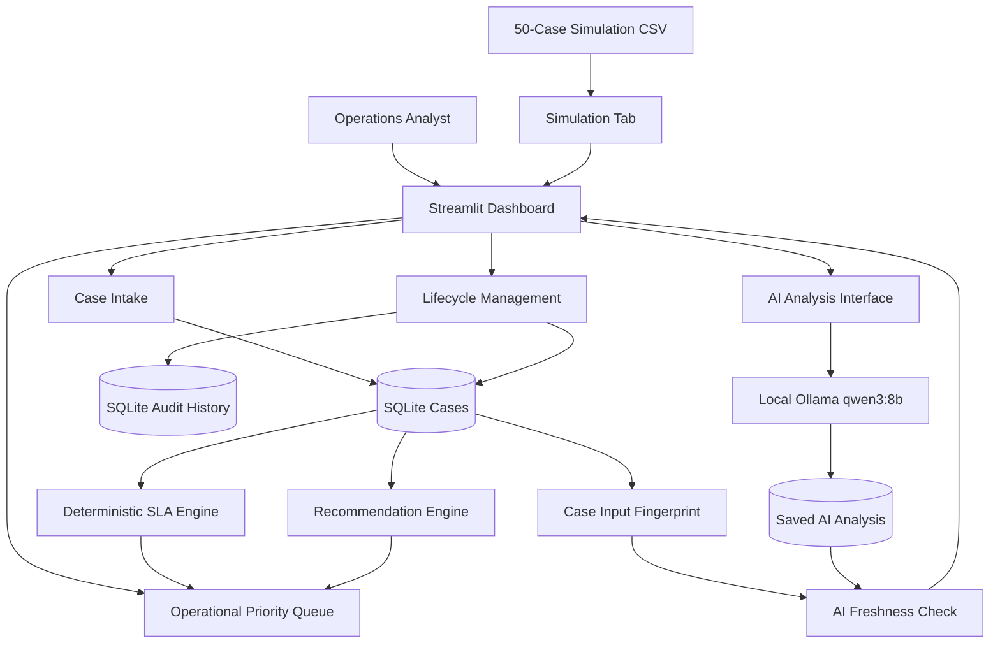

# System Architecture

## Component Diagram

## Design Principles

1. SQLite stores live case records and audit information.
2. Deterministic logic owns SLA risk and operational priority.
3. Ollama provides advisory case interpretation.
4. Input fingerprints detect stale AI analysis.
5. The original simulation remains separate from live cases.
6. Evaluation and validation reports are reproducible
   from saved project artifacts.

## Important Boundaries

The AI model does not establish legal requirements,
calculate authoritative government deadlines,
or override the deterministic SLA engine.

The architecture represents the local prototype,
not a production cloud deployment.
